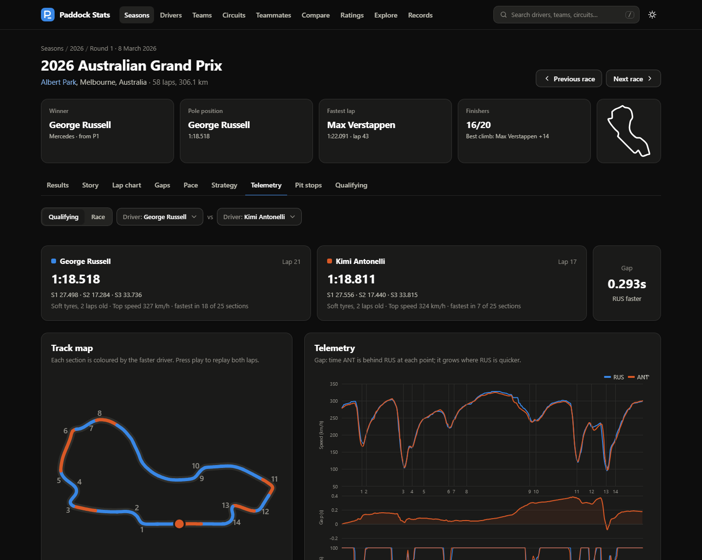
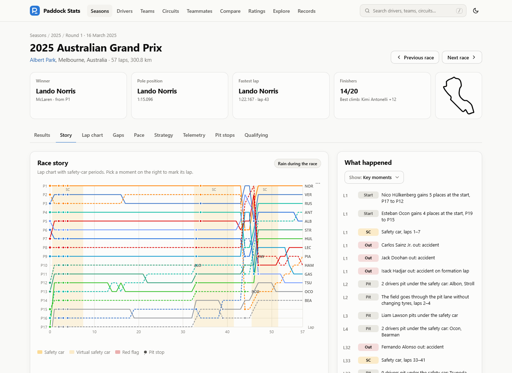
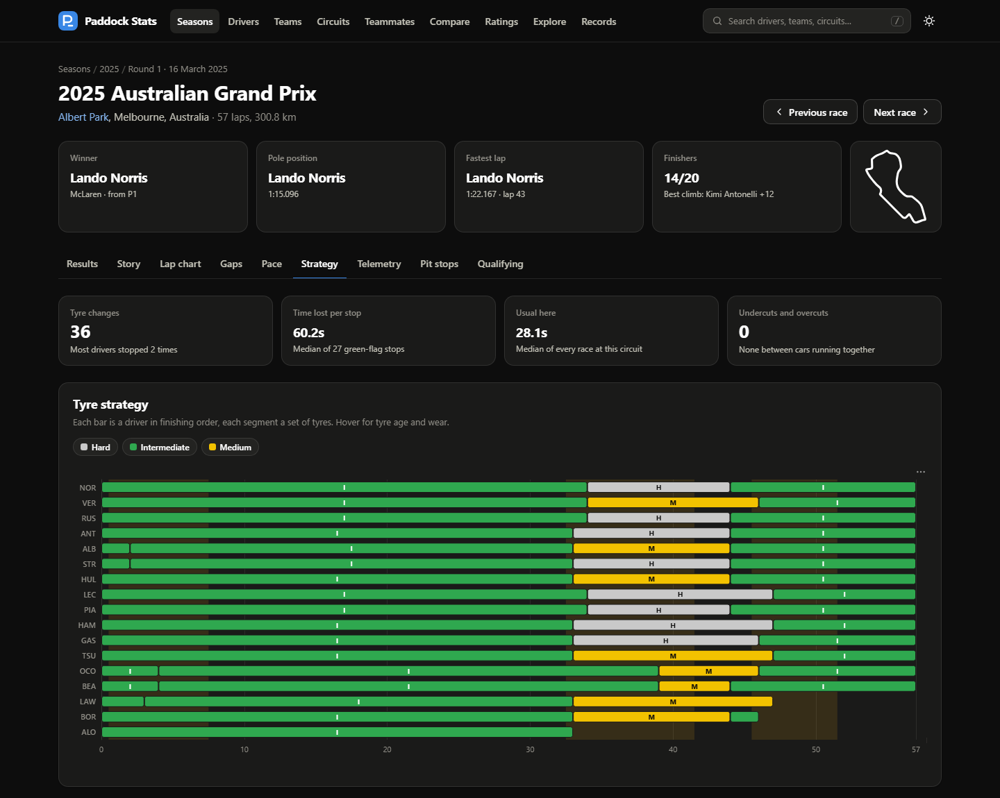
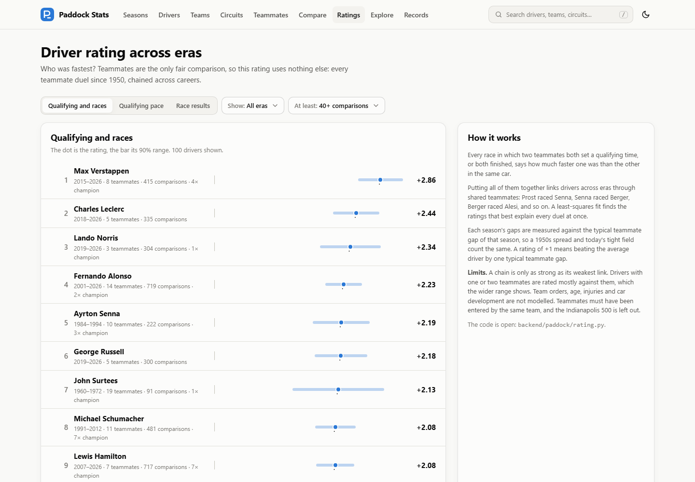
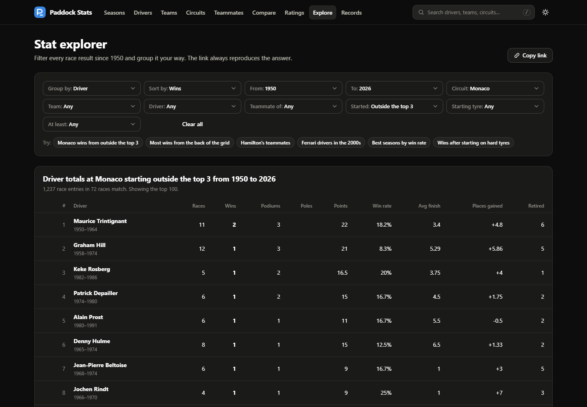
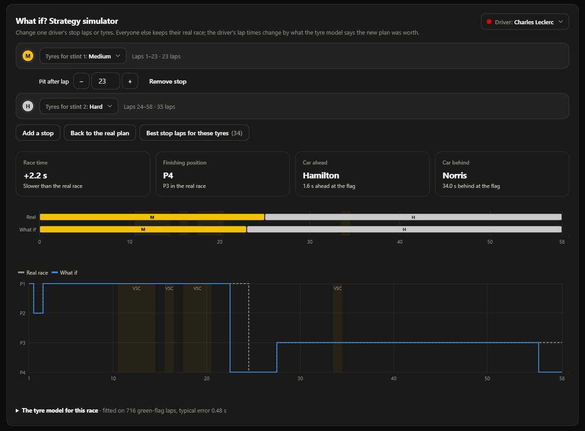
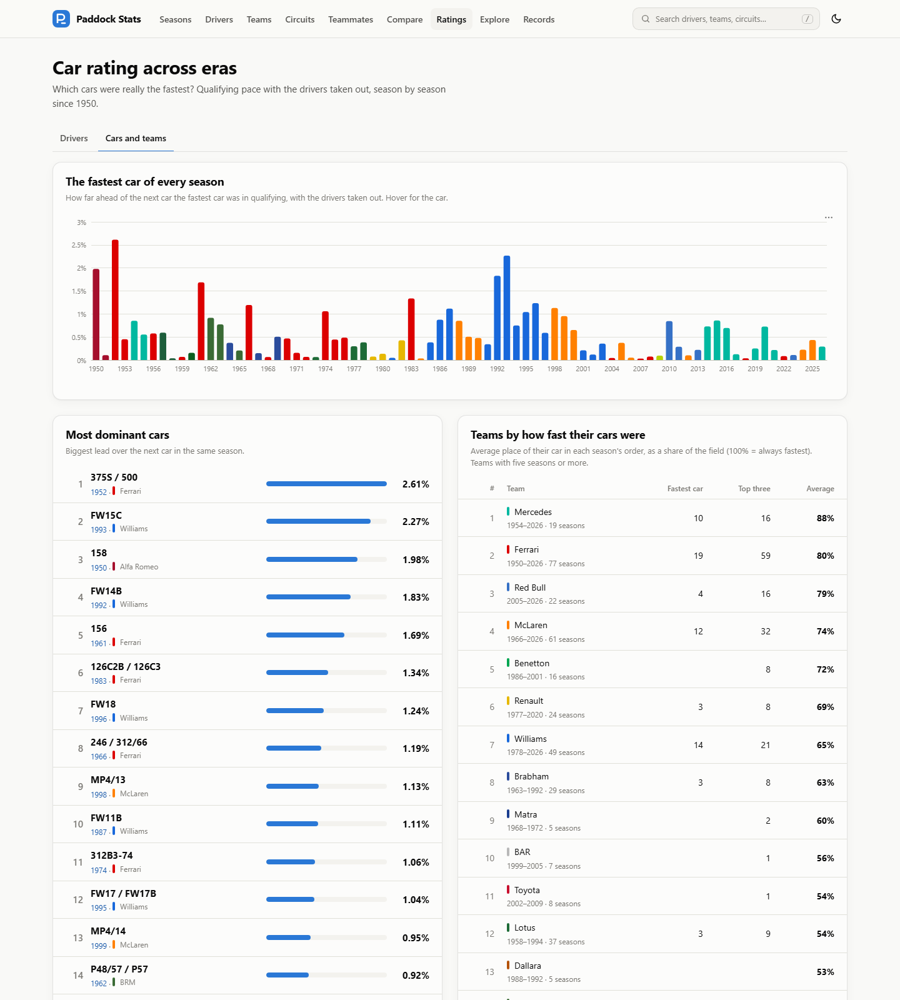
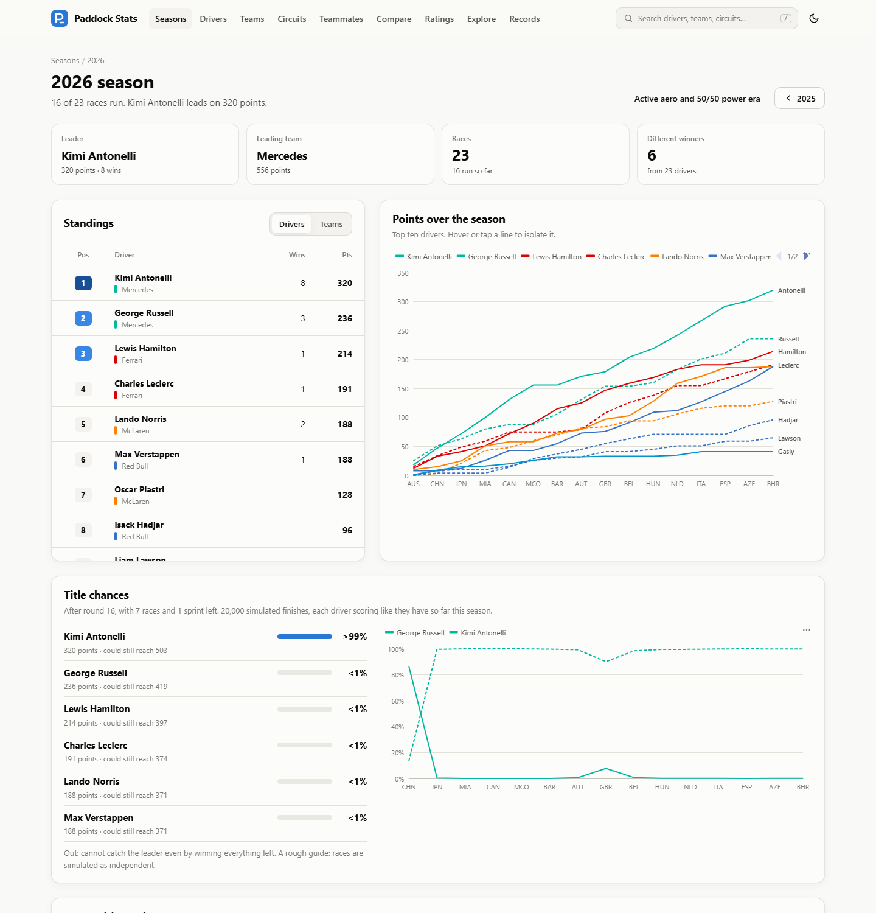
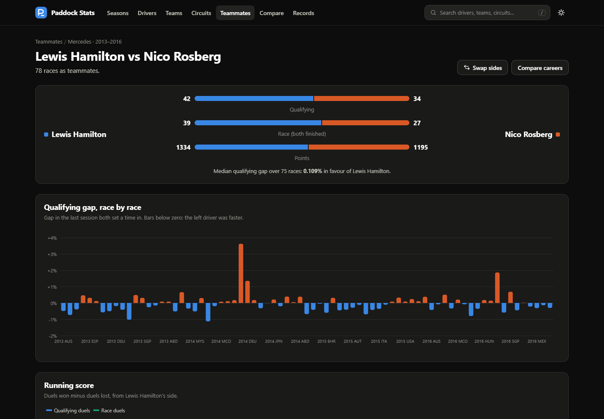
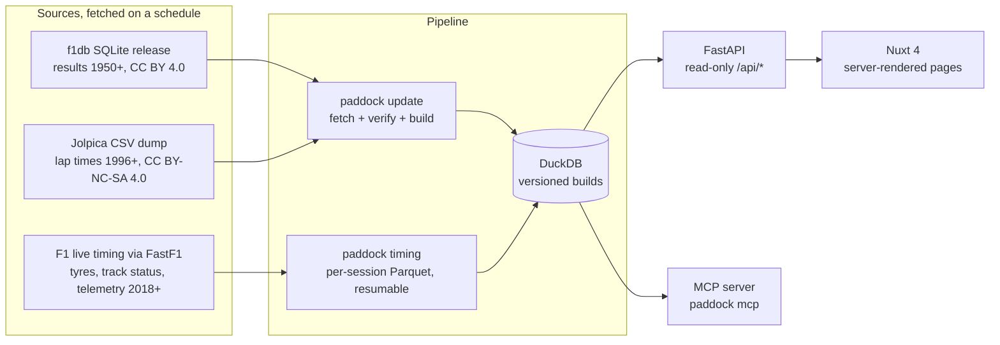

# Paddock Stats

Formula 1 statistics from 1950 to today, in the browser: every season, race, driver, team and circuit; lap-by-lap race
stories since 1996; tyres, safety cars and car telemetry since 2018; a head-to-head for every teammate pairing in the
history of the championship; and an open driver rating across eras. Every page, tab and filter is part of the URL, so
any view can be shared as a link, and the main charts can be downloaded or embedded.

Free, non-commercial and open source. Unofficial: not associated with the Formula 1 companies.



## What it does

**History (1950+)**
- **Seasons.** Standings, points after every round, a colour-coded grid of every result, the season **re-scored under
  any points system used since 1950**, the **competitive order** of the teams race by race, and **title chances**
  simulated from each driver's form, with who can still win.
- **Drivers.** Career totals, championship position per season, how every race ended, milestones, a duel record
  against **every teammate**, their **cross-era rating**, and links to every qualifying lap with telemetry.
- **Teams and cars.** Seasons with drivers, cars, engines and tyres, the team's lineage across name changes, reliability
  by cause, how fast the car was each season against the fastest car, and a page for every car with its engine,
  drivers, results and qualifying pace.
- **Circuits, eras and records.** Layouts, winners and lap records; how often the safety car comes out, red flags and
  wet races at every circuit (2018+); the regulation eras and who dominated them; all-time leaderboards.

**Races**
- **Story (1996+).** The lap chart with safety-car, virtual safety car and red-flag bands next to a timeline of what
  happened: start, lead changes, pit stops, retirements, penalties.
- **Lap chart and gaps (1996+).** Positions and gaps to the leader or any driver, lap by lap.
- **Pace.** Fuel-corrected lap times on green-flag laps, with tyre colours from 2018, and every stint's pace and wear.
- **Strategy.** Tyre stints by compound, how much time a pit stop cost, and which undercuts and overcuts worked.
- **Strategy simulator (2018+).** What if a driver had stopped two laps earlier, stopped once more, or fitted other
  tyres? A tyre model fitted on the race itself gives the new race time, finishing position and the best stop laps.
- **Telemetry (2018+).** Any two drivers' fastest laps in a session: speed, time gap, throttle, brake and gear along the
  lap, a track map coloured by the faster driver in each section with a replay of both laps, sectors, top speed and
  clipping (the 2026 power units' energy limit).
- **Qualifying.** Best sectors, the ideal lap each driver had in them, and the time left on the table.

**Comparisons and tools**
- **Teammate head-to-heads.** All pairings since 1950, ranked by how one-sided or close they were.
- **Compare.** Up to four careers side by side, aligned by race start or by age.
- **Driver rating across eras.** Built only from teammate comparisons chained across careers, with 90% intervals and
  the method explained on the page.
- **Car and team rating.** Every car since 1950 as a gap to the fastest car of its season, from qualifying pace with
  the drivers taken out: the most dominant cars and the teams whose cars were usually fastest.
- **Stat explorer.** Filter every result by years, circuit, team, driver, teammate, starting position and starting tyre,
  group it by driver, team, season or circuit, and share the answer as a link.
- **Sharing.** Every page has its own social preview card with its key numbers, and the main charts can be
  downloaded as images, linked to directly or embedded in another site.
- **MCP server.** Ask the data questions from Claude or any other MCP client.

| | |
| --- | --- |
|  |  |
|  |  |
|  |  |
|  |  |

## How it works



- **`paddock update`** downloads the [f1db](https://github.com/f1db/f1db) release and the
  [Jolpica-F1](https://github.com/jolpica/jolpica-f1) dump, checks their hashes and builds a DuckDB file in about eight
  seconds: results, laps matched to f1db's drivers, teammate pairings, retirement causes and the driver rating.
- **`paddock timing`** reads 2018+ sessions through [FastF1](https://github.com/theOehrly/Fast-F1) and keeps only what
  the site needs (laps, tyres, sectors, track status, race control, weather, each driver's fastest lap on a 10 m grid),
  about 300 KB per session. It respects FastF1's request limit, about 40 sessions an hour, and with `--wait` keeps
  going until everything is in. Visitors never cause requests to any data provider.
- Each build is a new database file named in `data/paddock.current`; the API switches to it on its next request, so
  rebuilding never interrupts the site.
- The **API** is a thin layer of SQL and NumPy over DuckDB, cached for five minutes. Telemetry is served one lap at a
  time for charts only.
- The **frontend** renders each page on the server so shared links have a real title and description. Charts are
  ECharts with one theme built from the site's colour tokens, in light and dark mode.

| Layer | Stack |
| --- | --- |
| Pipeline and API | Python 3.12, DuckDB, NumPy, FastAPI, FastF1, Pillow, httpx, pytest, ruff, uv |
| MCP | Official MCP Python SDK, stdio |
| Frontend | Nuxt 4, Vue 3, TypeScript (strict), ECharts, Vitest |
| Packaging | Docker, docker compose, GitHub Actions |

### API

Interactive documentation at `/api/docs` when the API is running. The main routes:

| Path | Returns |
| --- | --- |
| `/api/seasons/{year}` · `/progression` · `/results-grid` · `/rescore` | Season, points per round, every result, other points systems |
| `/api/seasons/{year}/title-odds` · `/competitive-order` | Simulated title chances; teams' gap to the fastest car |
| `/api/races/{year}/{round}` · `/laps` | Results, qualifying, sprint, pit stops; every lap of every driver (1996+) |
| `/api/races/{year}/{round}/story` · `/strategy` · `/pace` | Race story, tyre strategy and pit battles, fuel-corrected pace |
| `/api/races/{year}/{round}/simulate?driver=&stops=&compounds=` | Strategy simulator (2018+) |
| `/api/races/{year}/{round}/sessions` · `/telemetry` · `/qualifying-analysis` · `/straights` | 2018+ timing and telemetry |
| `/api/drivers/{id}` · `/results` · `/telemetry-laps` | Driver page data |
| `/api/teammates` · `/api/teammates/{a}/{b}` · `/api/compare?drivers=` | Head-to-heads and comparisons |
| `/api/explore?...` | Stat explorer |
| `/api/ratings?model=` · `/api/ratings/{id}` | Cross-era driver rating |
| `/api/car-ratings` · `/api/car-ratings/{year}` · `/api/car-ratings/team/{id}` | Car and team rating from qualifying pace |
| `/api/conditions` · `/api/circuits/{id}/conditions` | Safety cars, red flags and wet races per circuit (2018+) |
| `/api/constructors/{id}` · `/api/cars/{chassis}` · `/api/eras` · `/api/circuits/{id}` · `/pit-loss` | Teams, cars, eras, circuits |
| `/api/records/{board}` · `/api/search?q=` · `/api/meta` | Records, search, build information |
| `/api/og.png?title=&eyebrow=&sub=&stats=` | Social preview card (PNG, 1200x630) |

## Running locally

Prerequisites: Python 3.12, Node 24 and [uv](https://docs.astral.sh/uv/).

```bash
git clone https://github.com/GebleaAlex/Formula-1-F1-Paddock-Stats.git
cd Formula-1-F1-Paddock-Stats
```

```bash
# data and API
cd backend
uv sync --all-groups --all-extras
uv run paddock update                         # results and laps, about 30 MB, builds the database
uv run paddock timing --years 2026 2025 --wait  # optional: tyres, safety cars and telemetry, a few hours
uv run paddock serve --reload                 # http://localhost:8020/api/docs
```

```bash
# frontend (second terminal)
cd frontend
npm install
npm run dev                                   # http://localhost:3000
```

Or with Docker, which builds the data on first start: `docker compose up --build` and open `http://localhost:3000`.
When the site runs on a public address, set `NUXT_PUBLIC_SITE_URL` (e.g. `https://example.org`) so social previews
link to the right images.
After a race weekend, refresh with `uv run paddock update` (or `docker compose run --rm pipeline`), then add the new
sessions with `paddock timing --years <this year>`.

### Ask the data from Claude (MCP)

`paddock mcp` runs an MCP server on stdio with 18 tools: search, seasons, races, race story and strategy, the strategy
simulator, drivers, teammate head-to-heads, comparisons, records, the stat explorer, driver and car ratings, title
odds, safety cars and weather per circuit, qualifying analysis and lap comparisons. For Claude Code:

```bash
claude mcp add paddock-stats -- uv --directory /path/to/Formula-1-F1-Paddock-Stats/backend run paddock mcp
```

For Claude Desktop, add the same command to `claude_desktop_config.json` under `mcpServers`.

## Tests

```bash
cd backend && uv run pytest        # API tests against the real database, analysis and rating maths, MCP tools
cd frontend && npm test            # formatting, colours, race-gap maths, safety-car bands
cd frontend && npm run typecheck   # vue-tsc, strict
```

The API tests check facts that cannot change: Senna and Prost's 32 races as McLaren teammates, McLaren winning 15 of 16
races in 1988 with the MP4/4, Prost winning that title under today's points, Verstappen and Hamilton level going into
Abu Dhabi 2021. CI builds the database from the real sources and runs everything, plus the production build and both
Docker images.

## How the numbers are calculated

- **Teammates** are drivers entered by the same team with the same car in the same race (the Indianapolis 500 is left
  out). Whoever qualified ahead wins the qualifying duel; a race duel counts only when both were classified.
- **Qualifying gap**: the time in the last session both set a time in, as a percentage of the faster one.
- **Driver rating**: a least-squares fit of every teammate duel, with each season's gaps measured against that season's
  typical teammate gap, a small ridge penalty, and 90% intervals from the fit. See `backend/paddock/rating.py`.
- **Fuel correction**: about 100 kg of fuel at the start, burned evenly, at 0.03 s per kg per lap.
- **Green-flag laps**: not lap 1, not an in- or out-lap, no safety car, not more than 7% slower than the driver's median.
- **Pit-stop loss**: in-lap plus out-lap minus two of the driver's typical laps; the median over the race's green-flag
  stops (from 2018, stops under a safety car or virtual safety car are left out).
- **Strategy simulator**: lap time with fuel taken out = driver pace + tyre offset + tyre wear per lap of age + a track
  trend, fitted on the race's green-flag laps. Tyre numbers are shared by the field, wear is never negative and a softer
  tyre never wears more slowly than a harder one. A stop costs the race's pit loss, half of it under a safety car, 65%
  under a virtual safety car and nothing under a red flag. Only the chosen driver's race changes. See
  `backend/paddock/simulator.py`.
- **Safety cars and wet races**: from the race leader's track status (2018+); a safety car that only leads the field
  away after a red flag counts with the red flag. A race is wet when at least 10% of all laps were on intermediate or
  wet tyres.
- **Car rating**: every qualifying lap within 7% of pole, as a gap to pole, split by a ridge-regularised least-squares
  fit into one number per team per season (the car) and one per career (the driver). See `backend/paddock/cars.py`.
- **Undercut and overcut**: cars running next to each other within four seconds, one stopping first and the other
  within six laps, judged by the order after both stops; stops under a safety car are left out.
- **Title chances**: 20,000 simulations of the remaining races, each driver scoring like they have so far that season.
- **Clipping**: distance at full throttle over which the car still slows down, from each driver's fastest lap.

## Data and licences

| Data | Source | Licence |
| --- | --- | --- |
| Results, standings, entrants, cars, engines, circuits and layouts, 1950+ | [f1db](https://github.com/f1db/f1db) | CC BY 4.0 |
| Lap-by-lap times and positions, 1996+ | [Jolpica-F1](https://github.com/jolpica/jolpica-f1) | CC BY-NC-SA 4.0 |
| Tyres, sectors, track status, race control, weather, telemetry, 2018+ | Formula 1 live timing via [FastF1](https://github.com/theOehrly/Fast-F1) | No licence; charts only, never redistributed |

The code is licensed under the [Apache License 2.0](LICENSE). You may use, change and redistribute it, commercially
too, as long as you keep the [NOTICE](NOTICE) file that credits Alex Geblea as the original author, keep the licence,
and state that you changed the files you modified. The data keeps its own licences, see
[data/LICENSE.md](data/LICENSE.md): the lap data is non-commercial, so this site is non-commercial too (no ads, no
paid features), and a commercial version of the code would need other data. The site uses no Formula 1 or
team logos, official fonts or photographs; team colours are used only to tell cars apart.

---

Paddock Stats is unofficial and is not associated in any way with the Formula 1 companies. F1, FORMULA ONE, FORMULA 1,
FIA FORMULA ONE WORLD CHAMPIONSHIP, GRAND PRIX and related marks are trade marks of Formula One Licensing B.V.
